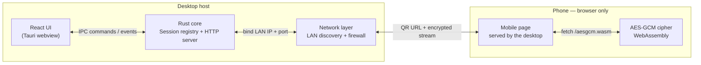
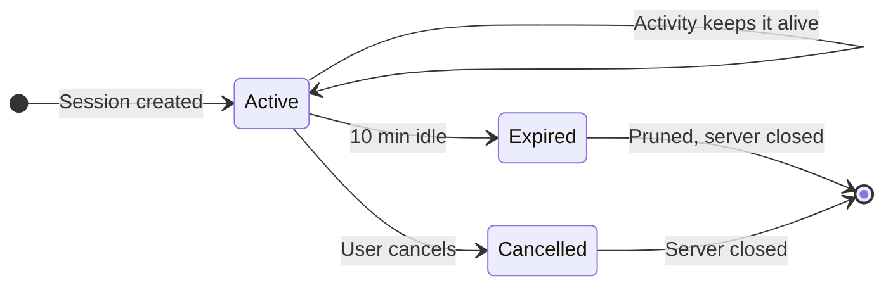

# AerLynk

> LAN file transfer, wrapped in a tamper-evident sleeve.

AerLynk is a desktop app that moves files between a PC and any phone **on the same Wi-Fi network** — no accounts, no cloud, no cables, and **no phone app required**. The phone just scans a QR code and uses its browser.

Every byte crossing the network is encrypted end-to-end with **AES-256-GCM**, and the session key travels only inside the QR code itself — it is never sent to the server, never logged, and never stored.


---

## Download (Windows)

> **Requirements:** Windows 10 or 11 with [WebView2](https://developer.microsoft.com/en-us/microsoft-edge/webview2/) (preinstalled on Windows 11 and updated Windows 10).

| What | File |
| --- | --- |
| **Installer** (recommended) | `AerLynk_<version>_x64-setup.exe` — available on the [Releases page](https://github.com/NACER1-EDDINE/AerLynk/releases) |
| MSI package | `AerLynk_<version>_x64_en-US.msi` — for managed/enterprise deployment |
| Portable | `AerLynk_<version>_x64_portable.exe` — standalone, no installation required |

**First run:** if your firewall blocks the transfer, AerLynk detects it and shows **"Firewall is blocking AerLynk → Repair now"** in the sidebar. One click adds the correct inbound rule (a Windows prompt appears — accept it).

**Updating:** run the newer installer over an existing install — it upgrades in place and keeps your settings.

## Linux (Fedora / Ubuntu / Debian)

> **Requirements:** a desktop environment with **WebKitGTK 4.1** (Fedora: `sudo dnf install webkit2gtk4.1` — most desktop installs already have it).

| What | File |
| --- | --- |
| **RPM** (Fedora / RHEL) | `AerLynk_<version>_amd64.rpm` — install with `sudo dnf install ./AerLynk_*.rpm` |
| **AppImage** (any distro) | `AerLynk_<version>_amd64.AppImage` — download, `chmod +x`, double-click to run |
| DEB (Ubuntu / Debian) | `AerLynk_<version>_amd64.deb` — `sudo apt install ./AerLynk_*.deb` |

On Fedora the RPM is the smoothest path; the AppImage works on every distro (if it will not launch, run it with `--appimage-extract-and-run`). Firewall handling is automatic — Linux has no program-scoped firewall rule to configure.

---

## Highlights

- **No phone app.** The desktop serves a fully self-contained mobile page plus a WebAssembly cipher module over the LAN; any phone browser works.
- **End-to-end encryption.** Files are chunk-encrypted with AES-256-GCM before they leave the device, in both directions.
- **QR pairing.** Scan a QR to join a session; verify with an unambiguous `XX-XX` display code shown on both devices.
- **Both directions.** Send files from the PC to the phone, or from the phone to the PC.
- **Multi-gigabyte files.** Streams with bounded memory — files are never buffered whole.
- **Smart LAN discovery.** Picks the real adapter and filters virtual ones (VPNs, WSL, Hyper-V, Docker, …), so the QR code always points somewhere reachable.
- **Upload safety.** In-flight uploads land in a quarantine folder, are decrypted and authenticated before release, never overwrite existing files, and hostile filenames are sanitized.
- **Firewall self-healing.** Detects a missing or stale Windows Firewall rule (including rules pointing at an old install path) and repairs it with one click.

---

## How it works

When a session starts, the desktop binds a small HTTP server to its LAN address on an ephemeral port (never `0.0.0.0`). The phone reaches it by scanning the QR code, which encodes the URL **plus the AES-256 session key in the URL fragment** — the fragment is never transmitted to the server, so the key stays between the two devices.



The cipher is one Rust crate, compiled twice: natively for the desktop and to `wasm32` for the phone. Both implementations are pinned against each other byte-for-byte by a cross-check script, so a phone can never disagree with the desktop about a single byte.

### Send: PC → phone

```mermaid
sequenceDiagram
    autonumber
    participant U as User
    participant A as Desktop app
    participant R as Rust backend
    participant P as Phone browser

    U->>A: Pick files to send
    A->>R: start_send_session(files)
    R->>R: Create session, AES-256 key, XX-XX code
    R-->>A: token + display code
    A-->>U: Show QR label (key in URL fragment)
    U->>P: Scan QR
    P->>R: GET /s/&lt;token&gt; — file listing
    R-->>P: File list + base nonce
    P->>P: Load AES-GCM wasm module
    P->>R: GET /s/&lt;token&gt;/f/&lt;id&gt; — encrypted stream
    R-->>P: Framed AES-GCM chunks (streamed, flat memory)
    P->>P: Decrypt chunk-by-chunk, reassemble
    P-->>U: Save file
```

### Receive: phone → PC

```mermaid
sequenceDiagram
    autonumber
    participant U as User
    participant A as Desktop app
    participant R as Rust backend
    participant P as Phone browser

    U->>A: Start a receive session
    A->>R: start_receive_session()
    R->>R: Create session, AES-256 key, XX-XX code
    R-->>A: token + display code
    A-->>U: Show QR label (key in URL fragment)
    U->>P: Scan QR
    P->>R: GET /r/&lt;token&gt; — upload page
    P->>P: Encrypt selected files in wasm
    P->>R: POST /r/&lt;token&gt; — encrypted multipart upload
    R->>R: Quarantine, decrypt, authenticate, verify
    R-->>P: Per-file result (done / failed)
    R->>R: Move verified files into Downloads
    R-->>A: session-delivered event
    A-->>U: Progress + result
```

---

## Security model

| Concern | How AerLynk handles it |
| --- | --- |
| Session identity | 256-bit CSPRNG token, URL-safe base64, compared in constant time |
| Session key | 256-bit, generated by the OS CSPRNG; travels **only** in the QR URL fragment |
| Human verification | 4-character display code from an unambiguous alphabet (no `0/O/1/I/L`), collision-checked, rendered identically on both devices |
| Transport | AES-256-GCM per 1 MiB chunk; per-chunk authentication tag; nonce derived from session base + chunk index |
| Wire exposure | Plaintext never appears on the wire — a flipped byte fails authentication, not decryption |
| Network exposure | Server binds only to the discovered LAN address, never `0.0.0.0` |
| Expiry | Sessions auto-expire after 10 minutes of inactivity and are pruned, closing the server with the last one |
| Upload caps | 500 files / 64 GiB per session, enforced atomically even under concurrent uploads |
| Path safety | Filenames sanitized (no `..` traversal); name collisions get a ` (1)` suffix instead of overwriting |
| Tampered uploads | Quarantined first; rejected ciphertext leaves no file behind |
| Unknown tokens | Indistinguishable 404 for missing, expired, or wrong-kind sessions |

Sessions live in a registry owned entirely by the Rust backend; the webview holds display state only.



> **Threat model:** AerLynk protects against passive sniffing on the LAN. An active man-in-the-middle is documented accepted risk — chunk integrity is per-chunk, so reordering and dropping are out of scope by design.

---

## Antivirus false positives (Windows Defender)

Windows Defender (and other AV products) may flag AerLynk as a threat
(e.g. `Trojan:Win32/Wacatac`-style heuristics). This is a **false positive**
caused by a behaviour fingerprint, not by anything malicious in the app:

1. **Unsigned executable.** Any unsigned binary that talks to the network is
   scored aggressively. The single biggest mitigation is code-signing the
   `.exe`/`.msi` with an OV or EV certificate (`tauri.conf.json` →
   `bundle > windows > certificateThumbprint`, or `signtool sign` in CI).
2. **Launching PowerShell.** The firewall status/repair feature spawns
   `powershell.exe` (`-NoProfile -NonInteractive -ExecutionPolicy Bypass`)
   and runs an elevated script for rule repair — the same primitives malware
   abuses, so heuristics flag unsigned apps doing it. All spawns use
   `CREATE_NO_WINDOW` (no flashing terminals), `-NoProfile -NonInteractive`,
   and the elevated script is written under the app's control with a
   deterministic name. An EV certificate largely stops these detections.
3. **LAN HTTP server + file downloads.** Binding a socket and writing files
   to `Downloads` is shared with dropper-style malware.

If Defender quarantines a build you compiled yourself from this repo, verify
the source (the entire protocol is in `src-tauri/src/` and
`crates/aerlynk-crypto/`), then submit the file to
[Microsoft's false-positive portal](https://www.microsoft.com/en-us/wdsi/filesubmission).
Signing the release artifacts is the long-term fix.

## Tech stack

| Layer | Technology |
| --- | --- |
| Desktop shell | [Tauri 2](https://tauri.app) (WebView2) |
| Frontend | React 19 · TypeScript 5.8 · Vite 7 · Tailwind CSS 4 · CSS motion |
| Backend | Rust (tokio + axum) embedded HTTP server |
| Crypto | `aerlynk-crypto` — AES-256-GCM chunked streaming, native **and** `wasm32` |
| Phone client | Self-contained mobile page + WebAssembly cipher, served from the desktop |
| Platform | Windows (firewall integration, WebView2) · Linux (WebKitGTK 4.1, rpm/deb/AppImage) |

---

## Repository layout

```
aerlynk/
├── src/                      # React UI (Tauri webview)
│   ├── components/           # Sidebar, QrCard, Dropzone, FileList, Icons
│   ├── hooks/                # transfer, drag-drop, settings, history, network, spotlight
│   ├── views/                # SendView, ReceiveView, HistoryView, SettingsView
│   └── lib/                  # IPC bridge, formatting
├── src-tauri/                # Rust desktop backend (Tauri 2)
│   ├── src/
│   │   ├── server/           # axum HTTP server: pages, download, upload, assets
│   │   ├── session.rs        # session registry: tokens, keys, caps, expiry
│   │   ├── net.rs            # LAN IPv4 discovery (filters virtual adapters)
│   │   ├── firewall.rs       # Windows Firewall check / repair
│   │   ├── safety.rs         # filename sanitization, quarantine handling
│   │   ├── reachability.rs   # self-test + phone-reachability diagnostics
│   │   ├── commands.rs       # Tauri IPC command layer
│   │   └── server_manager.rs # server lifecycle
│   └── build.rs              # compiles the wasm cipher into the binary
├── crates/aerlynk-crypto/    # AES-256-GCM chunked cipher (native + wasm32)
├── scripts/                  # native ↔ wasm byte-for-byte cross-check + runtime sim
├── installer/                # firewall helper script (bundled)
└── public/                   # fonts, logo source, static assets
```

---

## Getting started

### Prerequisites

- [Node.js](https://nodejs.org) 20+
- [Rust](https://rustup.rs) (stable)
- Tauri 2 prerequisites for Windows — [WebView2](https://developer.microsoft.com/en-us/microsoft-edge/webview2/) and the MSVC build tools
- The `wasm32-unknown-unknown` Rust target (needed to compile the phone cipher):

```bash
rustup target add wasm32-unknown-unknown
```

### Run in development

```bash
npm install
npm run tauri dev
```

### Build an installer

```bash
npm run tauri build
```

The build compiles the desktop app **and** the `wasm32` cipher, then embeds `aesgcm.wasm` into the binary via `build.rs` — the phone client is always served from inside the app, never fetched from the internet.

### Tests

```bash
cargo test --workspace          # unit + integration tests (Rust)
node scripts/wasm-cross-check.mjs  # native ↔ wasm cipher agreement
```

The native ↔ wasm cross-check requires a fixture generated by the native build and the wasm artifact; run it after any change to `aerlynk-crypto`:

```bash
cargo test -p aerlynk-crypto print_wasm_fixture
cargo build -p aerlynk-crypto --target wasm32-unknown-unknown --release --target-dir target-wasm
node scripts/wasm-cross-check.mjs
```

A multi-gigabyte flat-memory exit-criteria test is included but deliberately ignored for normal runs:

```bash
cargo test -p aerlynk -- --ignored
```

---

## Status

AerLynk is at **v0.1.1** — the end-to-end encrypted send and receive flows work over a real LAN. The desktop UI ships a dark, glassy "atmosphere" design with QR-pairing, live progress, and a history of past transfers; the phone pages are a polished, fully self-contained client (branded header, session code, live progress, trust footer) that works in any mobile browser.

---

## Credits

Made by **NACEREDDINE**. Your name in the credits is the only "account" you will ever need in AerLynk — there are none.
